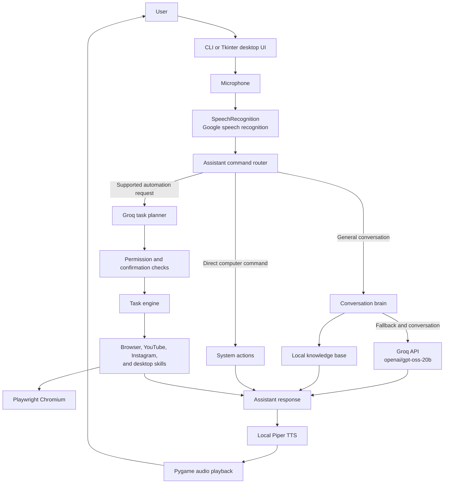

# SARATHI - Personal AI Voice Assistant

SARATHI is a Windows-first desktop voice assistant built with Python. It combines voice input and output, conversational AI, a small local knowledge base, direct computer commands, and browser automation in a modular project.

For conversational responses and natural-language task planning, SARATHI calls the **Groq API** using the `openai/gpt-oss-20b` model. This is a cloud API integration: SARATHI does not run Ollama or a language model locally. Speech recognition also uses Google's online recognition service, while speech synthesis uses a local Piper voice model.

> **API naming:** This project uses **Groq** (`GROQ_API_KEY`), not xAI's **Grok** API.

## Features

| Area | What SARATHI provides |
|---|---|
| Voice input | Captures microphone audio and transcribes English (`en-IN`) with SpeechRecognition and Google's recognition service |
| AI conversation | Sends general questions to Groq and retains a short, in-process conversation history |
| Local knowledge | Uses exact and strong matches from `core/knowledge_base.json` before calling the AI |
| Voice output | Converts replies to speech with a local Piper voice and plays them with Pygame |
| Desktop interface | Tkinter HUD with microphone controls, status indicators, and action confirmation prompts |
| Desktop commands | Opens common folders and apps, searches the web or YouTube, writes notes, and runs selected system utilities |
| Browser automation | Uses Playwright with a persistent Chromium profile for browser, YouTube, and Instagram tasks |
| Task permissions | Separates supported browser actions from actions that require user confirmation |

Some features use online services. Groq requests and speech recognition require an internet connection. Piper speech synthesis runs locally after its voice model is available.

## Architecture



The assistant routes supported direct commands and task-agent requests separately from general conversation. The task planner produces a structured action plan; the task engine dispatches only registered actions, and configured actions ask for confirmation before proceeding.

## Project structure

```text
SARATHI/
├── config/                 # Reserved for configuration
├── core/
│   ├── assistant.py        # Routes messages, commands, and automation requests
│   ├── brain.py            # Groq conversation client, memory, and knowledge lookup
│   ├── browser_manager.py  # Persistent Playwright Chromium lifecycle
│   ├── knowledge_base.json # Local question-and-answer data
│   ├── permissions.py      # Action categories and confirmation messages
│   ├── system_actions.py   # Direct desktop and Windows system operations
│   ├── task_engine.py      # Registered action dispatch and execution
│   └── task_planner.py     # Converts natural-language tasks to structured plans
├── notes/                  # Project notes
├── skills/
│   ├── browser.py          # General browser open and search actions
│   ├── desktop.py          # Desktop utilities such as screenshots
│   ├── instagram.py        # Instagram browser tasks
│   └── youtube.py          # YouTube browser and playback tasks
├── ui/
│   └── app.py              # Tkinter desktop HUD
├── voice/
│   ├── listener.py         # Microphone capture and speech recognition
│   ├── speaker.py          # Piper synthesis and Pygame playback
│   └── tts_test.py         # TTS experiment
├── voices/                 # Piper ONNX voice models and metadata
├── browser_data/            # Created at runtime; persistent browser profile
├── list_voices.py           # Voice/model helper
├── main.py                 # Command-line voice assistant entry point
├── test_groq.py            # Groq API smoke test
├── requirements.txt        # Python dependencies
├── LICENSE
└── README.md
```

| Component | Responsibility |
|---|---|
| `core/` | Conversation, command routing, local knowledge, permissions, and task execution |
| `skills/` | Reusable browser and desktop actions exposed to the task engine |
| `voice/` | Microphone input, text-to-speech, and audio playback |
| `ui/` | Graphical Tkinter interface |
| `voices/` | Local Piper voice models; the speaker currently selects the English model |
| `browser_data/` | Persistent Chromium state such as cookies and browser settings; treat this as private local data |

`browser_data/` is created when browser automation starts and is excluded from Git. Do not commit or share it: the browser profile may contain login sessions and other private data. The Hindi Piper model is included in `voices/`, but the current speaker configuration uses the English model.

## Requirements

| Requirement | Notes |
|---|---|
| Windows | The project includes Windows-specific desktop and system operations |
| Python 3.12 or newer | Use a 64-bit Python installation |
| Groq API key | Required for AI conversation and task planning |
| Microphone | Required for voice input |
| Internet connection | Required for Groq and online speech recognition |
| Chromium | Installed for Playwright browser automation |

## Installation

Open PowerShell in the project directory:

```powershell
git clone https://github.com/Bhushangcoe/SARATHI.git
cd SARATHI

py -3.12 -m venv .venv
.\.venv\Scripts\Activate.ps1

python -m pip install --upgrade pip
pip install -r requirements.txt
python -m playwright install chromium
```

If PowerShell prevents virtual-environment activation, use the Python executable directly instead:

```powershell
.\.venv\Scripts\python.exe -m pip install -r requirements.txt
.\.venv\Scripts\python.exe -m playwright install chromium
```

## Configure the Groq API

Create a Groq API key from your Groq account, then set it in the PowerShell session before starting SARATHI:

```powershell
$env:GROQ_API_KEY = "your-groq-api-key"
```

The environment variable must be present in the shell that launches the app. To save it for future PowerShell sessions, set a user-level environment variable and open a new terminal:

```powershell
[Environment]::SetEnvironmentVariable("GROQ_API_KEY", "your-groq-api-key", "User")
```

Never paste a real API key into source code, `README.md`, screenshots, or commits. The configured model is `openai/gpt-oss-20b` in `core/brain.py` and `core/task_planner.py`.

## Run SARATHI

Start the command-line voice assistant:

```powershell
python main.py
```

Or start the Tkinter desktop interface:

```powershell
python -m ui.app
```

Speak in English after the assistant is ready. Say `exit`, `quit`, or `bye` to leave the command-line assistant.

## Example capabilities

| Request | Example |
|---|---|
| Web search | "Search for weather in Pune" |
| YouTube | "Search YouTube for fast bowling drills" |
| Desktop | "Open Downloads" |
| Browser automation | "Open YouTube and search for jazz music" |
| Instagram navigation | "Open Instagram messages" |
| Voice conversation | Ask a general question to get a response from the Groq-backed assistant |

Available automation depends on the registered actions in `core/task_engine.py` and the current implementation of each skill. Actions that may change an account or publish content are designed to request confirmation before execution.

## Development and troubleshooting

- **Groq connection or key error:** Check that `GROQ_API_KEY` is set in the current terminal and that the machine can reach the Groq API.
- **Microphone errors:** Check Windows microphone permissions and the selected device in `voice/listener.py` (`MICROPHONE_INDEX`).
- **Browser automation errors:** Install Chromium with `python -m playwright install chromium`. The browser profile is stored in `browser_data/`.
- **Piper voice errors:** Confirm the selected `.onnx` model and its matching `.onnx.json` metadata file are present in `voices/`.
- **Audio or PyAudio errors:** Check the Windows audio device and the PyAudio installation for the active Python version.

The Groq API smoke test can be run after setting `GROQ_API_KEY`:

```powershell
python test_groq.py
```

## License

See [LICENSE](LICENSE) for the terms that apply to this project.
